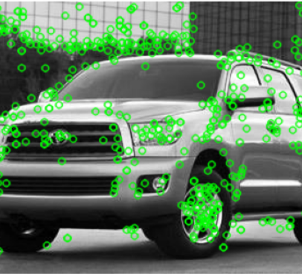
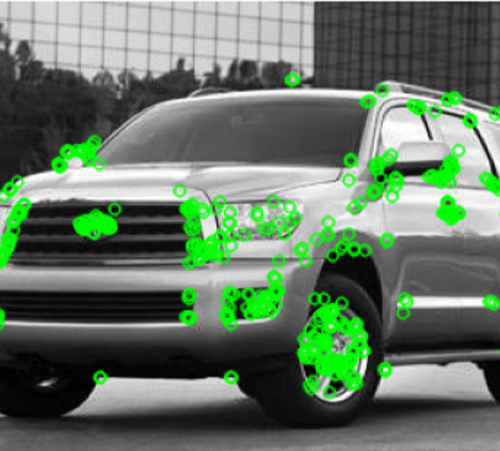
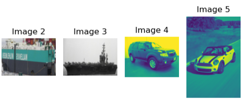
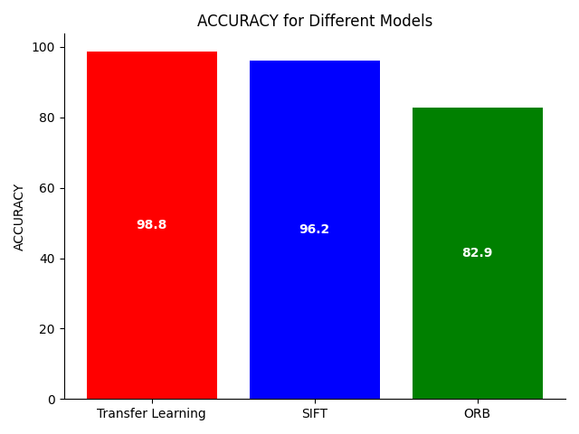
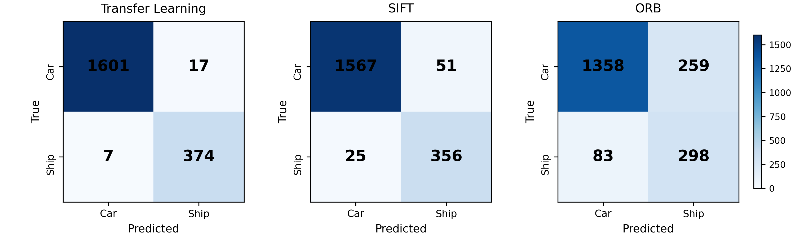
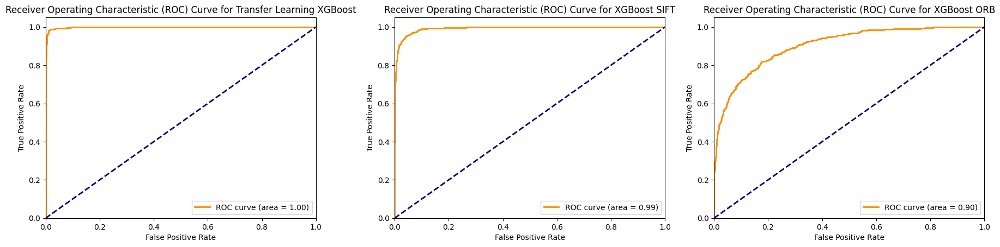
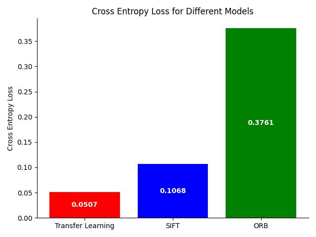
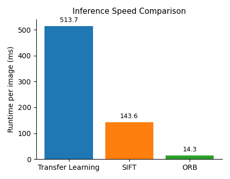
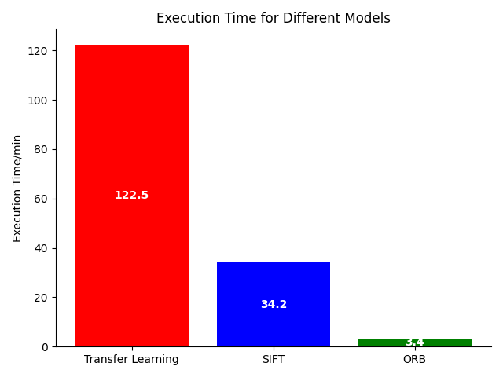

# Comparative Feature Extraction: SIFT, ORB, and Deep Learning

**Status Note:** This repository contains the full source code and results for the paper, "**Evaluating Traditional and Deep Feature Extraction Techniques with Logistic Regression and XGBoost Classifiers**." The full paper will be linked here upon official publication.

---

### Project Objectives

This research provides a rigorous benchmark of feature extraction techniques for image classification, focused on determining the optimal trade-off between **classification accuracy** and **computational efficiency** for practical deployment.

* **Feature Methods Compared:** SIFT, ORB, and ResNet50 Transfer Learning.
* **Classification Pipeline:** Consistent two-stage model: Logistic Regression (Baseline) and XGBoost (Ensemble Meta-Classifier).
* **Dataset:** 14,306 labeled images of **Cars** and **Ships**.

### 1. Visual Feature Extraction

The methodology contrasts low-level handcrafted features (SIFT/ORB) with high-level learned features (ResNet50).

| SIFT (DoG Keypoints) | ORB (FAST Keypoints) | Transfer Learning Feature Map |
| :---: | :---: | :---: |
|  |  | |  
| *SIFT uses Difference of Gaussian (DoG) for keypoint detection, resulting in uniform distribution across the image.* | *ORB uses the FAST detector, which typically concentrates keypoints on high-texture areas and object edges.* | *ResNet50 generates a high-dimensional feature vector, representing abstract, high-level image structures.* |

---

### 2. Key Performance Benchmarks

The core findings highlight the superiority of deep features for accuracy versus traditional methods for speed.

#### A. Accuracy and Discriminative Power

| Test Score | Confusion Matrices | ROC Curves (AUC) |
| :---: | :---: | :---: |
|  |  |  |
| **Finding:** Transfer Learning achieves the highest test accuracy (**98.80%**) and near-perfect class separation (AUC $1.00$). SIFT is a competitive second (**96.20%**). | **Finding:** Confusion matrices confirm the superior performance of Transfer Learning across both classes (Cars/Ships). | **Finding:** The ROC curves show the high discriminative power of deep features, followed closely by SIFT. |

#### B. Execution Efficiency

| Cross Entropy Loss (Confidence) | Runtime per Image (Latency) | Total Execution Time (Min) |
| :---: | :---: | :---: |
|  |  |  |
| **Finding:** Transfer Learning achieves the lowest loss (**0.0507**), indicating high confidence. ORB has the highest loss (**0.3761**). | **Finding:** ORB is the fastest at **14.3 ms per image**, ideal for real-time systems. Transfer Learning is the slowest at **513.7 ms**. | **Finding:** ORB requires the least time (**3.40 min**) for the full pipeline, whereas Transfer Learning requires the most (**122.48 min**). |

---

### 3. Repository and Code Usage

The core code for all three extraction methods and the combined classification pipeline is available in the notebooks below.

* **`AML_VGK.ipynb`**: Implementation of the **Transfer Learning (ResNet50) + LogReg/XGBoost** pipeline.
* **`SIFT.ipynb`**: Implementation of the **SIFT + LogReg/XGBoost** pipeline.
* **`ORB.ipynb`**: Implementation of the **ORB + LogReg/XGBoost** pipeline.
